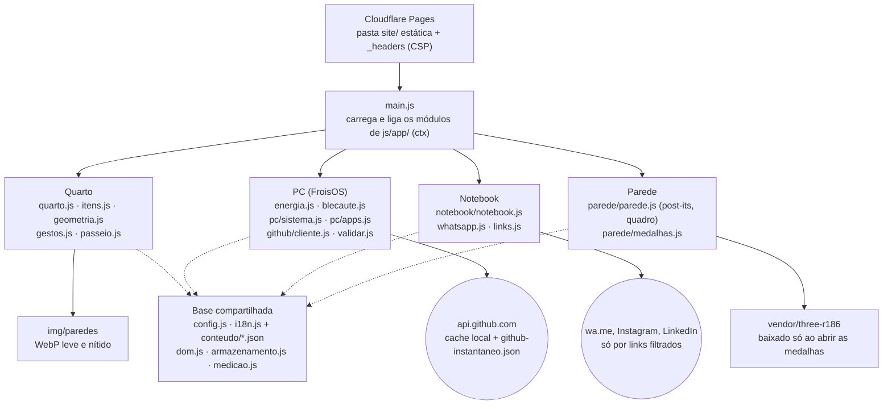

# Arquitetura do site (05/11/2026)

Desenho feito a partir do grafo do Graphify (`graphify-out/`). Para ver o grafo completo e interativo, abra `graphify-out/graph.html` no navegador.

## Pontos que o grafo mostra

| Ponto | O que quer dizer |
|---|---|
| Até 05/11/2026, `montarApp()` em `main.js` tinha 46 ligações | Foi dividido em 9 módulos em `site/js/app/` (A1); o maior, `instalarModos()`, tem 14. Os módulos se falam pelo objeto `ctx`, sem importar uns aos outros. |
| `el()`, `botao()` e `icone()` (em `dom.js`) vêm logo depois | Toda a interface é montada por essas três funções. Uma mudança visual passa por elas. |
| Nenhum ciclo de importação | Os módulos dependem só "para baixo" (da base). Isso precisa continuar assim. |
| Módulos sem tela (`energia`, `blecaute`, `whatsapp`, `links`, `github/`, `armazenamento`) têm testes no Node | A refatoração do front-end pode mexer nas telas sem quebrar essas regras, desde que os testes continuem verdes. |

## Fora do grafo, de propósito (`.graphifyignore`)

`site/vendor/` (Three.js de terceiros), `site/img/`, `site/conteudo/`, páginas `.html`, `.md`, `.txt` e `.github/`. O grafo fica só com o código, sem custo de extração.
